<h1 align="center">Want to Know My IT Journey? 🚀</h1>

  

<picture>
  <source media="(prefers-color-scheme: dark)" srcset="https://raw.githubusercontent.com/Trixjohn/Trixjohn/pacman-output/pacman-contribution-graph-dark.svg">
  <source media="(prefers-color-scheme: light)" srcset="https://raw.githubusercontent.com/Trixjohn/Trixjohn/pacman-output/pacman-contribution-graph.svg">
  
</picture>

<h2 align="center">Technologies I Use</h2>

  
  
  
  
  
  
  
  
  
  
  
  
  

<h2 align="center">Connect With Me</h2>

  
  
  

